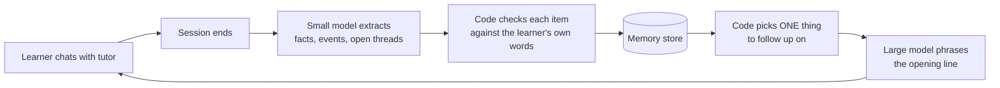

# Tutor memory

**Problem.** Miss Maya is PeerUp's AI tutor. Every call started from zero. A learner would mention an interview on Friday, and on Saturday Maya had no idea. It felt like talking to a stranger each time.

**What I built.** A memory system that carries a learner across sessions, and a working chatbot to test it.

**How the AI is used.**
- A large model does the talking. A small, cheap model does the remembering: extracting, summarising and tidying.
- Plain code decides what counts as true. An item is saved only if it traces back to something the learner actually said.
- Code also picks what to bring up next, using a fixed order: an event that just passed, then one coming up, then an unfinished topic. The model only writes the sentence.

**What went wrong.**
- The small model got calendar maths wrong ("next Friday" landed on the wrong date) even with a calendar in the prompt. Dates are now worked out in code from the learner's exact words.
- The model renamed things. A "result announcement" came back as an "interview". The follow-up prompt now has to keep the learner's meaning exactly.
- Maya repeated the same follow-up. Fixed with a simple flag in code, not a prompt instruction.

**Where it stands.** Covered by 100+ unit tests and an eval suite that checks hard rules (never invent a fact) and scores the quality of opening lines.
