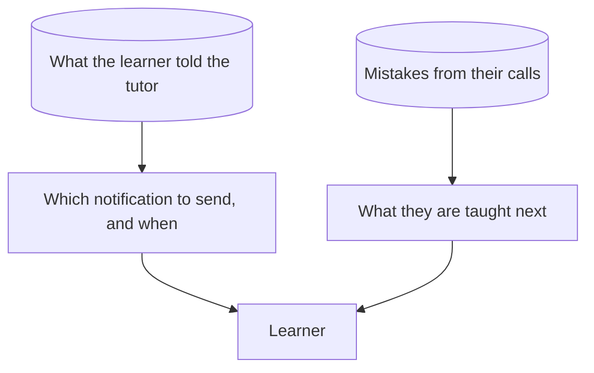

# Personalisation engine

**Problem.** Every learner got the same reminders at the same time and the same lessons in the same order. A shy beginner and a confident speaker were treated alike.

**What I built.** Two kinds of personalisation that share the same inputs.

**Personal, not just "Hi {name}".**
- **Notifications.** The engine reads what the learner has shared (an exam next week, a job interview, a topic they enjoyed) and decides which message is worth sending and when to send it.
- **Learning.** After each call, the learner's mistakes are scored and grouped. The areas they slip on most often become their next lessons, so two learners at the same level can end up with different plans.

**Design choices.**
- The same rule as the tutor memory: code decides what to send and when, the model only writes it.
