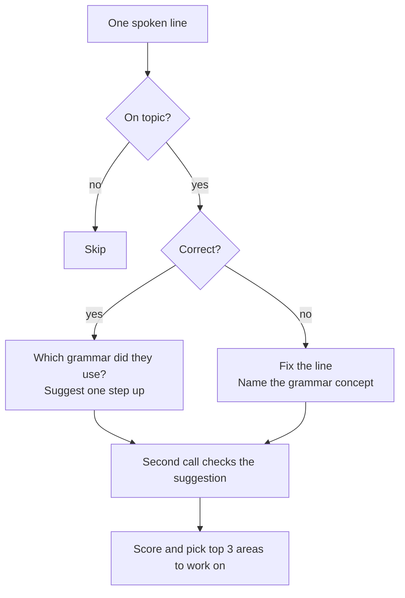

# Post-call feedback

**Problem.** After a speaking call, learners got feedback from one large prompt that judged the whole conversation at once. It missed mistakes, flagged correct sentences, and when it was wrong there was no way to tell why.

**What I built.** A chain of small checks that runs on each line the learner spoke.

**How the AI is used.**
- Each step is a narrow prompt with one job, so each can be tested alone.
- Every mistake is mapped to one of 170+ grammar concepts and a CEFR level (A1 to C2).
- A second call reviews every suggested improvement and drops it if it changes the meaning, adds a fact, or sounds unnatural.
- Quoted words are verified in code against what the learner actually said.

**A decision made from data.** The first scoring idea was "mistakes per 100 words". I looked at 1,500+ real learner lines: mistakes per line stayed steady across short and long sentences, while mistakes per word swung wildly. So scoring is per line.

**Output.** The learner sees their top three areas to work on, and for each line, a better way to say it at one level above their own.
